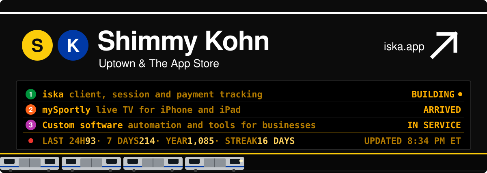

  

I'm Shimmy, a developer in New York. I like taking an idea all the way: the data model, the backend, the app in your hand, and the boring parts that keep it running.

## What I'm building

**[iska](https://iska.app)** is my main thing: client, session and payment tracking for professionals who would rather spend time with clients than with spreadsheets. It's a native Swift app with a web companion, built at [@iska-llc](https://github.com/iska-llc).

**Operations software for The Nuttery NY.** A reporting portal, Windows sync tools for the point of sale and accounting systems, and the automations that tie them together, so the store can see what happened yesterday without anyone exporting a file.

## On the side

- **[mySportly](https://github.com/shimmykohn/mySportly)**: a native SwiftUI live TV app for iPhone and iPad that organizes a huge channel catalog around the teams and leagues you follow.
- **Fammiliar**: a small PWA that helps sibling families coordinate Shabbos visits and reminders.
- **Leagues**: a camp league tracker, built for one summer and used every day of it.

## What I reach for

`Swift` `SwiftUI` `TypeScript` `Next.js` `Appwrite` `Node.js` `C#` `n8n`

## Say hi

The best place to see what I'm up to is [iska.app](https://iska.app).
